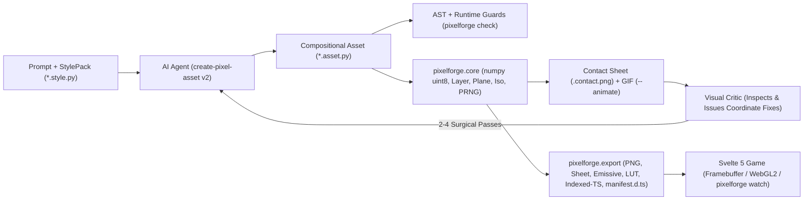

# pixelforge

Deterministic Python compositional indexed pixel art compiler (`build123d`-style), CLI/SDK, and multimodal AI agent visual critic loop for producing pixel-perfect PNGs, animated spritesheets, emissive masks, typed Svelte 5 manifests, and indexed `Uint8Array` framebuffer bundles with zero mixels.

**[English](README.md)** | **[Português (Brasil)](README.pt-br.md)**

[-3776AB.svg)](https://www.python.org/)
[](https://github.com/microsoft/pyright)
[](https://docs.astral.sh/ruff/)
[](docs/DESIGN_V2.md)

---

## Overview

`pixelforge` eliminates the structural failure modes of raster image-diffusion pixel art (mixels, blurry alpha halos, cross-asset palette drift, jittery animation frames, and silent PNGs without anchor coordinates) by authoring assets as compositional Python modules (`*.asset.py`) over a `numpy` `uint8` indexed framebuffer.

Core capabilities ([`docs/DESIGN_V2.md`](docs/DESIGN_V2.md)):
- **Compositional `build123d`-Style API:** Context managers (`with a.layer(...)`, `with a.plane(...)`) with automatic outlines, selective outlines (`sel_out`), mirroring, affine `(u, v)` projection (`rect`, `grid`, `line`, `dot`, `anchor`), `2:1` isometric primitives (`iso_box`, `iso_tile`), and 1px surgical escape hatches (`put`, `erase`, `spr`).
- **Zero-Mixel Indexed Framebuffer:** Integer-coordinate `numpy.ndarray(dtype=np.uint8)` surfaces (`0..254` semantic palette indices, `255` permanently reserved for binary alpha `0`).
- **Semantic Palettes & LUT Swaps:** Named color tokens with material flags (`outline`, `emissive`, `bright`, `shadow`, `metal`, `accent`) and `reflections` tables enabling lossless state/time swaps (`healthy`/`dusty`/`faulty`, `day`/`night`) without redrawing geometry.
- **Headless Millisecond Exports:** Vectorized `numpy` + `Pillow` encoding outputting 1× (or `--scale N`) binary-alpha PNGs, horizontal spritesheets, emissive masks, optional `--lut` textures, `manifest.json` + **`manifest.d.ts`**, and **`--indexed-ts`** RLE/base64 `Uint8Array` bundles for Svelte 5 games.
- **Multimodal Visual Critic Loop:** Generates `.contact.png` diagnostic sheets (1× dark/light strips, zoomed grid with `(x, y)` coordinate rulers, hitbox/anchor overlays, untruncated palette swatches) and animated `.gif` previews (`--animate`) so AI agents inspect rendered pixels and apply exact coordinate-level edits.
- **AST + Runtime Guard Suite:** Static `ast.parse` and runtime checks blocking `random`/`secrets`/`numpy.random`, external raster imports, raw `#rrggbb` literals, I/O/`eval`, out-of-palette pixels, non-binary alpha, and non-deterministic outputs.

## Architecture



Architectural trade-offs are recorded in [`docs/adr/decisions.md`](docs/adr/decisions.md), and full contracts live in [`docs/DESIGN_V2.md`](docs/DESIGN_V2.md).

## Quickstart

### Prerequisites

- Python `>= 3.14`
- [`uv`](https://docs.astral.sh/uv/)

### Local Setup

```bash
cp .env.example .env
uv sync --frozen
uv run pytest
```

## Configuration

Optional environment overrides declared in [`.env.example`](.env.example) (loaded via `pydantic-settings` with the `PIXELFORGE_` prefix):

| Variable | Description | Default | Required |
| :--- | :--- | :--- | :--- |
| `PIXELFORGE_OUT_DIR` | Output directory for exported PNGs, spritesheets, emissive masks, `manifest.json`, `manifest.d.ts`, and `indexed/` | `dist` | No |
| `PIXELFORGE_SHEETS_DIR` | Directory for ephemeral visual-critic `.contact.png` sheets (git-ignored) | `.pixelforge/sheets` | No |
| `PIXELFORGE_PREVIEWS_DIR` | Directory for ephemeral animated `.gif` previews (git-ignored) | `.pixelforge/previews` | No |
| `PIXELFORGE_DIFFS_DIR` | Directory for ephemeral pixel-diff PNGs generated by `pixelforge diff` (git-ignored) | `.pixelforge/diffs` | No |
| `PIXELFORGE_DEFAULT_STYLE` | Default `StylePack` identifier used by `pixelforge init` | `homelab-16bit` | No |
| `LLM_BASE_URL` | Optional OpenAI v1 gateway endpoint (`hydra-llm-router`) for Phase 3 automated critic mode | `http://127.0.0.1:3000/v1` | No |
| `LLM_API_KEY` | Optional gateway token when Phase 3 automated critic mode is enabled | `sk-replace-with-hydra-tier-token` | Only for Phase 3 automated mode |
| `LLM_MODEL_FAST` | Low-latency virtual model alias on the LLM gateway | `fast` | No |
| `LLM_MODEL_DEEP` | Reasoning virtual model alias on the LLM gateway | `deep` | No |
| `LLM_TIMEOUT_SECONDS` | HTTP timeout in seconds for deep reasoning gateway calls | `180` | No |

## CLI Reference

```bash
# Scaffold starter StylePack, sample .asset.py, and .env.example
uv run pixelforge init [--style homelab-16bit] [--force] [--root .]

# Compile .asset.py modules into PNGs, spritesheets, emissive masks, manifests, and diagnostics
uv run pixelforge render [asset_id] [--out dist] [--sheet] [--animate] [--emissive] [--lut] [--indexed-ts] [--scale 1] [--variant <name>] [--root .]

# Execute AST static and runtime guard checks (exit code 0 on pass)
uv run pixelforge check [asset_id] [--strict-orphans] [--root .]

# Generate a side-by-side + magenta pixel-diff PNG against a git ref
uv run pixelforge diff <asset_id> [--base HEAD] [--out .pixelforge/diffs] [--scale 1] [--variant <name>] [--root .]

# Watch .asset.py and .style.py files and hot-reload compiled outputs
uv run pixelforge watch [asset_id] [--out dist] [--sheet] [--emissive] [--lut] [--indexed-ts] [--scale 1] [--variant <name>] [--interval 0.5] [--max-cycles N] [--root .]

# Extract an ephemeral aspect ratio, palette histogram, and quantized ASCII sketch from a local reference image
uv run pixelforge analyze-ref <image_path> [--style homelab-16bit] [--size 32x32] [--root .]
```

## Svelte 5 Integration

- **Standard PNG + WebGL2 Workflow:** Run `pixelforge render --emissive --lut` (or `pixelforge watch --out ../my-svelte-game/static/sprites`) to emit `manifest.json` and `manifest.d.ts` with strict TypeScript types for sprite IDs, state names, frame counts, FPS, anchors, and hitboxes.
- **CPU Indexed Framebuffer Workflow (`--indexed-ts`):** Pass `--indexed-ts` to emit `dist/indexed/palette.generated.ts` (`PALETTE_HEX`, `EMISSIVE`, `BRIGHT`, `REFL`), `dist/indexed/sprites.generated.ts` (RLE/base64 `Uint8Array` index buffers with `255 = transparent`), and `dist/indexed/manifest.generated.ts` for direct `Framebuffer.blit()` composition. Filtered `render <asset_id> --indexed-ts` and `watch <asset_id> --indexed-ts` still compile all sibling assets belonging to the affected `StylePack` into `dist/indexed/` so partial runs never truncate the TypeScript bundle.

## Development

### Project Structure

```text
├── .agent/
│   ├── TASK.md                    # Active task checklist and roadmap
│   ├── NOTES.md                   # Active module/CLI contracts and gotchas
│   ├── INVARIANTS.md              # Rendering and interface verification guardrails
│   ├── ARCHIVE.md                 # Archived task cycles
│   └── skills/create-pixel-asset/ # Hermetic asset authoring & critic skill
├── docs/
│   ├── DESIGN_V2.md               # Canonical v2 Python specification & contracts
│   └── adr/decisions.md           # Architectural Decisions Log (ADR diary)
├── src/pixelforge/
│   ├── core/                      # IndexedSurface, StylePack, PRNG, Iso, Plane, Asset/Layer
│   ├── export/                    # PNG/GIF, bundle, svelte_types, indexed_ts, contact_sheet, diff
│   ├── guard/                     # AST static rules, runtime rules, runner
│   └── cli/                       # Thin CLI entrypoint and pydantic-settings config
├── tests/                         # Hermetic pytest suites (core, export, guard, cli)
├── .env.example                   # Environment variable template
├── pyproject.toml                 # uv, ruff, pyright strict, pytest configuration
└── AGENTS.md                      # Engineering constitution and agent rules
```

### Validation Commands

All checks below must exit with code `0` before marking any task complete:

```bash
uv sync --frozen
uv run ruff check . && uv run ruff format --check .
uv run pyright
uv run pytest
git diff --check
```

## License

Apache License 2.0 — see [LICENSE](LICENSE).
