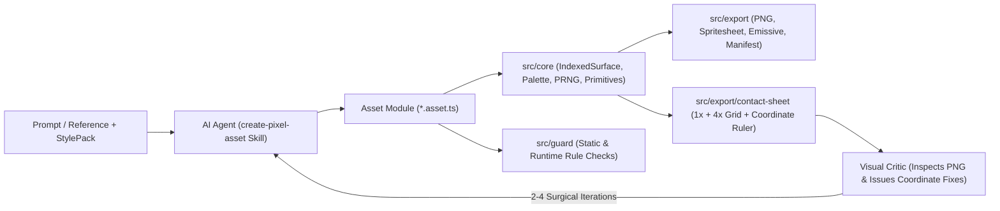

# pixelforge

Deterministic code-drawn indexed pixel art engine, CLI/SDK, and multimodal AI agent visual critic loop for producing pixel-perfect PNGs, animated spritesheets, emissive masks, and typed manifests with zero mixels.

**[English](README.md)** | **[Português (Brasil)](README.pt-br.md)**

[-339933.svg)](https://nodejs.org/)
[](https://www.typescriptlang.org/)
[](docs/DESIGN_MVP.md)

---

## Overview

`pixelforge` eliminates the structural failure modes of raster image-diffusion pixel art (mixels, blurry alpha halos, cross-asset palette drift, jittery animation frames, and silent PNGs without anchor coordinates) by authoring assets as deterministic TypeScript modules over an indexed `Uint8Array` framebuffer.

Key capabilities targeted by the MVP ([`docs/DESIGN_MVP.md`](docs/DESIGN_MVP.md)):
- **Zero-Mixel Indexed Framebuffer:** Integer-coordinate `Uint8Array` surfaces (`0..254` semantic palette indices, `255` reserved for binary alpha `0`), supporting 2D and `2:1` isometric primitives (`rect`, `line`, `dither`, `spr`, `autoOutline`, `isoBox`, `edgeMask`).
- **Semantic Palettes & LUT Swaps:** Named color tokens with material flags (`outline`, `emissive`, `shadow`, `metal`, `accent`) enabling lossless state/time swaps (`healthy`/`dusty`/`faulty`, `day`/`night`) without redrawing geometry.
- **Headless Millisecond Exports:** Pure Node.js encoding (`< 50ms` per sprite, zero browser dependency) outputting 1x PNGs, horizontal spritesheets, emissive masks, and code-coupled `manifest.json` metadata (anchors and hitboxes).
- **Multimodal Visual Critic Loop:** Generates `.contact.png` diagnostic sheets (1x dark/light previews, 4x/8x zoomed grid with `(x, y)` coordinate rulers, all states/frames, and palette swatches) so AI agents inspect rendered pixels and apply exact coordinate-level edits.
- **Deterministic Guard Tests:** Static and runtime checks blocking `Math.random`, external raster imports, raw hex strings, out-of-palette pixels, non-binary alpha, and non-deterministic outputs.

## Architecture



Architectural trade-offs are recorded in [`docs/adr/decisions.md`](docs/adr/decisions.md), and full contracts live in [`docs/DESIGN_MVP.md`](docs/DESIGN_MVP.md).

## Quickstart

> Current repository state: greenfield specification complete (`[00.0]`). Toolchain bootstrap and CLI implementation begin in Task `[00.1]` ([`.agent/TASK.md`](.agent/TASK.md)).

### Prerequisites

- Node.js `>= 24` (recommended: **Node.js 26 Active LTS**)
- `pnpm`

### Planned Local Workflow (post-`[00.1]`)

```bash
cp .env.example .env
pnpm install --frozen-lockfile
pnpm test
pnpm build
```

## Configuration

Optional environment overrides declared in [`.env.example`](.env.example):

| Variable | Description | Default | Required |
| :--- | :--- | :--- | :--- |
| `PIXELFORGE_OUT_DIR` | Output directory for exported PNGs, spritesheets, emissive masks, and `manifest.json` | `dist` | No |
| `PIXELFORGE_SHEETS_DIR` | Directory for ephemeral visual-critic `.contact.png` sheets (git-ignored) | `.pixelforge/sheets` | No |
| `PIXELFORGE_DEFAULT_STYLE` | Default `StylePack` identifier used by `pixelforge init` | `homelab-16bit` | No |
| `LLM_BASE_URL` | Optional OpenAI v1 gateway endpoint (`hydra-llm-router`) for Phase 3 automated critic mode | `http://127.0.0.1:3000/v1` | No |
| `LLM_API_KEY` | Optional gateway token when Phase 3 automated critic mode is enabled | `sk-replace-with-hydra-tier-token` | Only for Phase 3 automated mode |
| `LLM_MODEL_FAST` | Low-latency virtual model alias on the LLM gateway | `fast` | No |
| `LLM_MODEL_DEEP` | Reasoning virtual model alias on the LLM gateway | `deep` | No |
| `LLM_TIMEOUT_SECONDS` | HTTP timeout in seconds for deep reasoning gateway calls | `180` | No |

## CLI Reference (Planned MVP Surface)

```bash
# Scaffold a StylePack and sample asset module
pixelforge init --style homelab-16bit

# Render 1x PNGs, horizontal spritesheets, emissive masks, manifest.json, and contact sheet
pixelforge render old_laptop --sheet --emissive

# Execute static and runtime guard checks (exit code 0 on pass)
pixelforge check

# Generate a side-by-side + pixel-diff comparison against a git ref
pixelforge diff old_laptop --base HEAD
```

## Development

### Project Structure

```text
├── .agent/
│   ├── TASK.md              # Active task checklist and roadmap
│   ├── NOTES.md             # Active module/CLI contracts and gotchas
│   ├── INVARIANTS.md        # Rendering and interface verification guardrails
│   ├── ARCHIVE.md           # Archived task cycles
│   ├── hooks/               # Worktree and verification lifecycle hooks
│   ├── knowledge/           # Atomic platform/runtime gotcha cards
│   └── skills/              # Hermetic project skills (create-pixel-asset in [02.2])
├── docs/
│   ├── DESIGN_MVP.md        # Canonical MVP specification & contracts
│   └── adr/decisions.md     # Architectural Decisions Log (ADR diary)
├── src/                     # Engine core, exporter, guard runner, CLI (created in [00.1]+)
├── styles/                  # StylePack definitions (homelab-16bit pilot in [03.1])
├── assets/                  # Code-drawn *.asset.ts modules (pilot pack in [03.1])
├── tests/                   # Hermetic Vitest unit and guard test suites
├── .env.example             # Environment variable template
└── AGENTS.md                # Engineering constitution and agent rules
```

### Validation Commands

Canonical checks configured in `[00.1]` and required before completing any task:

```bash
pnpm typecheck
pnpm lint
pnpm test
pnpm build
git diff --check
```

## License

Private / Internal (`ye-sandbox`).
