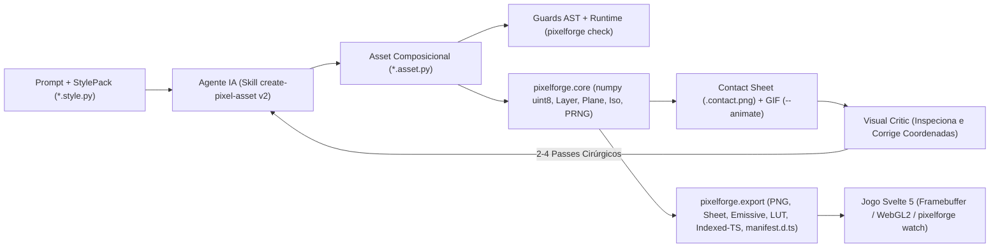

# pixelforge

Compilador determinístico e composicional de pixel art indexada em Python (estilo `build123d`), CLI/SDK e ciclo de auto-crítica visual por agentes multimodais de IA para gerar PNGs pixel-perfect, spritesheets animados, máscaras emissivas, manifestos tipados para Svelte 5 e pacotes de framebuffer `Uint8Array` sem mixels.

**[English](README.md)** | **[Português (Brasil)](README.pt-br.md)**

[-3776AB.svg)](https://www.python.org/)
[](https://github.com/microsoft/pyright)
[](https://docs.astral.sh/ruff/)
[](docs/DESIGN_V2.md)

---

## Visão Geral

O `pixelforge` elimina os modos de falha estruturais de geradores de pixel art baseados em difusão raster (mixels, halos semi-transparentes, deriva de paleta entre sprites, instabilidade entre frames de animação e PNGs sem metadados de âncoras) ao modelar cada asset como um módulo Python composicional (`*.asset.py`) sobre um framebuffer indexado `numpy` `uint8`.

Capacidades principais ([`docs/DESIGN_V2.md`](docs/DESIGN_V2.md)):
- **API Composicional Estilo `build123d` e Kits de Prefabs:** Gerenciadores de contexto (`with a.layer(...)`, `with a.plane(...)`) com contorno automático, contorno seletivo (`sel_out`), espelhamento, projeção afim `(u, v)` (`rect`, `grid`, `line`, `dot`, `anchor`), primitivas isométricas `2:1` (`iso_box`, `iso_tile`), `prefabs` reutilizáveis (`architecture`, `furniture`, `details` e `atmosphere` com janelas recortadas, ciclos dia/noite, clima animado e projeção de luz em `iso-2:1` e `front-2.5d`) e escapes cirúrgicos de 1px (`put`, `erase`, `spr`).
- **Framebuffer Indexado Sem Mixels:** Superfícies `numpy.ndarray(dtype=np.uint8)` em coordenadas inteiras (índices semânticos `0..254`, com `255` permanentemente reservado para alpha binário `0`).
- **Paletas Semânticas e Troca por LUT:** Tokens nomeados com flags de material (`outline`, `emissive`, `bright`, `shadow`, `metal`, `accent`) e tabelas `reflections` permitindo alternância sem perdas entre estados/horários (`healthy`/`dusty`/`faulty`, `day`/`night`) sem redesenhar a geometria.
- **Exportação Headless em Milissegundos:** Codificação vetorizada com `numpy` + `Pillow` gerando PNGs 1× (ou `--scale N`) com alpha binário, spritesheets horizontais, máscaras emissivas, texturas `--lut` opcionais, `manifest.json` + **`manifest.d.ts`** e pacotes **`--indexed-ts`** (`Uint8Array` RLE/base64) para jogos Svelte 5.
- **Ciclo de Crítica Visual Multimodal:** Gera folhas diagnósticas `.contact.png` (faixas 1× em fundo claro/escuro, grid ampliado com régua `(x, y)`, sobreposição de hitboxes/âncoras, swatches sem truncamento) e previews animados `.gif` (`--animate`) para inspeção e correção cirúrgica por coordenada.
- **Suíte de Guards AST + Runtime:** Checagens estáticas via `ast.parse` e em tempo de execução bloqueando `random`/`secrets`/`numpy.random`, imports de imagens externas, hex literais `#rrggbb`, I/O/`eval`, pixels fora da paleta, alpha intermediário e saídas não determinísticas.

## Arquitetura



As decisões arquiteturais estão registradas em [`docs/adr/decisions.md`](docs/adr/decisions.md) e a especificação completa de contratos está em [`docs/DESIGN_V2.md`](docs/DESIGN_V2.md).

## Início Rápido

### Pré-requisitos

- Python `>= 3.14`
- [`uv`](https://docs.astral.sh/uv/)

### Configuração Local

```bash
cp .env.example .env
uv sync --frozen
uv run pytest
```

### Consumo em Repositórios Externos

Instale o `pixelforge` como ferramenta CLI standalone ou adicione-o como dependência em um repositório consumidor externo (por exemplo, um jogo Svelte 5) e aponte para esse repositório com `--root`:

```bash
# Opção A: Instalar globalmente como ferramenta isolada do uv
uv tool install git+https://github.com/yegear/pixelforge.git
pixelforge init --root /caminho/para/repo-consumidor
pixelforge check --sync-stubs --root /caminho/para/repo-consumidor
pixelforge render --emissive --lut --indexed-ts --root /caminho/para/repo-consumidor

# Opção B: Executar de forma efêmera sem instalação global
uvx --from git+https://github.com/yegear/pixelforge.git pixelforge render --root /caminho/para/repo-consumidor

# Opção C: Adicionar ao pyproject.toml do repositório consumidor
# uv add --dev "pixelforge @ git+https://github.com/yegear/pixelforge.git"
uv run pixelforge watch --out static/sprites --serve
```

Quando `--root <caminho>` é informado, o `pixelforge` resolve `styles/`, `assets/`, `.env` (sobrescritas `PIXELFORGE_*`), `dist/` e `.pixelforge/` a partir de `<caminho>`, independentemente do diretório de trabalho atual.

## Configuração

Sobrescritas opcionais de ambiente declaradas em [`.env.example`](.env.example) (carregadas via `pydantic-settings` com prefixo `PIXELFORGE_`):

| Variável | Descrição | Padrão | Obrigatória |
| :--- | :--- | :--- | :--- |
| `PIXELFORGE_OUT_DIR` | Diretório de saída para PNGs exportados, spritesheets, máscaras emissivas, `manifest.json`, `manifest.d.ts` e `indexed/` | `dist` | Não |
| `PIXELFORGE_SHEETS_DIR` | Diretório de folhas efêmeras `.contact.png` de crítica visual (ignorado no Git) | `.pixelforge/sheets` | Não |
| `PIXELFORGE_PREVIEWS_DIR` | Diretório de prévias animadas efêmeras `.gif` (ignorado no Git) | `.pixelforge/previews` | Não |
| `PIXELFORGE_DIFFS_DIR` | Diretório de PNGs efêmeros de diff de pixels gerados por `pixelforge diff` (ignorado no Git) | `.pixelforge/diffs` | Não |
| `PIXELFORGE_DEFAULT_STYLE` | Override opcional de `StylePack` para `pixelforge init` (`sweetie-16`) e comandos multi-estilo | _(auto / vazio)_ | Não |
| `LLM_BASE_URL` | Endpoint opcional de gateway OpenAI v1 (`hydra-llm-router`) para modo crítico automatizado na Fase 3 | `http://127.0.0.1:3000/v1` | Não |
| `LLM_API_KEY` | Token opcional do gateway quando o modo crítico automatizado da Fase 3 estiver ativo | `sk-replace-with-hydra-tier-token` | Apenas no modo automatizado (Fase 3) |
| `LLM_MODEL_FAST` | Alias virtual de baixa latência no gateway LLM | `fast` | Não |
| `LLM_MODEL_DEEP` | Alias virtual de raciocínio profundo no gateway LLM | `deep` | Não |
| `LLM_TIMEOUT_SECONDS` | Timeout HTTP em segundos para chamadas de raciocínio profundo no gateway | `180` | Não |

## Referência da CLI

```bash
# Inicializar StylePack inicial, módulo .asset.py de exemplo e .env.example
uv run pixelforge init [--style sweetie-16] [--force] [--root .]

# Compilar módulos .asset.py em PNGs, spritesheets, máscaras emissivas, manifestos e diagnósticos
uv run pixelforge render [asset_id] [--out dist] [--sheet] [--animate] [--emissive] [--lut] [--normals] [--height] [--indexed-ts] [--indexed-ts-lazy] [--atlas {aseprite,texturepacker,all}] [--scale 1] [--variant <name>] [--format llm|json|human] [--json] [--human] [--root .]

# Executar guard tests estáticos (AST) e de runtime (código de saída 0 se aprovado)
uv run pixelforge check [asset_id] [--strict-orphans] [--format llm|json|human] [--json] [--human] [--root .]

# Gerar comparação lado a lado + diff de pixels em magenta contra uma ref Git
uv run pixelforge diff <asset_id> [--base HEAD] [--out .pixelforge/diffs] [--scale 1] [--variant <name>] [--summary-md <path>] [--format llm|json|human] [--json] [--human] [--root .]

# Observar arquivos .asset.py e .style.py e recompilar saídas automaticamente (opcional --serve Preview Studio)
uv run pixelforge watch [asset_id] [--out dist] [--sheet] [--emissive] [--lut] [--normals] [--height] [--indexed-ts] [--indexed-ts-lazy] [--atlas {aseprite,texturepacker,all}] [--scale 1] [--variant <name>] [--interval 0.5] [--max-cycles N] [--serve] [--host 127.0.0.1] [--port 4173] [--format llm|json|human] [--json] [--human] [--root .]

# Extrair proporção, histograma de paleta e rascunho ASCII quantizado efêmeros de uma imagem de referência local
uv run pixelforge analyze-ref <image_path> [--style homelab-16bit] [--size 32x32] [--scaffold [--id ASSET_ID] [--out PATH] [--force]] [--format llm|json|human] [--json] [--human] [--root .]

# Compor props filhos sobre âncoras declaradas de uma cena pai e validar limites/oclusão
uv run pixelforge compose <parent_id> --mount <prop_id>@<anchor>[:<prop_anchor>] [--state <name>] [--strict-bounds] [--sheet] [--format llm|json|human] [--json] [--human] [--root .]

# Pontuar assets e cenas alterados via crítico multimodal interno hydra-llm-router (OpenAI v1, modelo virtual 'fast')
uv run pixelforge critic [asset_id] [--base HEAD] [--threshold 70] [--variant <name>] [--summary-md <path>] [--format llm|json|human] [--json] [--human] [--root .]

# Inspecionar grupos de tokens de StylePack, assinaturas de prefabs, âncoras/estados de assets e montagens de cenas
uv run pixelforge inspect {style|presets|prefabs|api|assets|scenes} [target] [--format llm|json|human] [--json] [--human] [--root .]
```

## Integração com Svelte 5

- **Fluxo Padrão PNG + WebGL2:** Execute `pixelforge render --emissive --lut` (ou `pixelforge watch --out ../my-svelte-game/static/sprites`) para emitir `manifest.json` e `manifest.d.ts` com tipagem TypeScript estrita para IDs de sprites, estados, contagem de frames, FPS, âncoras e hitboxes.
- **Fluxo Framebuffer Indexado em CPU (`--indexed-ts`):** Passe `--indexed-ts` para gerar `dist/indexed/palette.generated.ts` (`PALETTE_HEX`, `EMISSIVE`, `BRIGHT`, `REFL`), `dist/indexed/sprites.generated.ts` (buffers `Uint8Array` em RLE/base64 com `255 = transparente`) e `dist/indexed/manifest.generated.ts` para composição direta via `Framebuffer.blit()`. Execuções filtradas `render <asset_id> --indexed-ts` e `watch <asset_id> --indexed-ts` ainda compilam todos os assets irmãos do `StylePack` afetado em `dist/indexed/` para que execuções parciais nunca trunquem o pacote TypeScript.

## Desenvolvimento

### Estrutura do Projeto

```text
├── .agent/
│   ├── TASK.md                    # Checklist da tarefa ativa e roadmap
│   ├── NOTES.md                   # Contratos ativos de módulos/CLI e gotchas
│   ├── INVARIANTS.md              # Guardrails de renderização e verificação de interface
│   ├── ARCHIVE.md                 # Ciclos de tarefas arquivados
│   └── skills/create-pixel-asset/ # Skill hermética de autoria e crítica visual
├── docs/
│   ├── DESIGN_V2.md               # Especificação canônica v2 Python e contratos
│   └── adr/decisions.md           # Diário de Decisões Arquiteturais (ADRs)
├── src/pixelforge/
│   ├── core/                      # IndexedSurface, StylePack, PRNG, Iso, Plane, Asset/Layer, Prefabs (architecture/furniture/details/atmosphere)
│   ├── export/                    # PNG/GIF, bundle, svelte_types, indexed_ts, contact_sheet, diff
│   ├── guard/                     # Regras estáticas AST, regras de runtime, runner
│   └── cli/                       # Entrypoint fino da CLI e configuração pydantic-settings
├── tests/                         # Suítes herméticas pytest (core, export, guard, cli)
├── .env.example                   # Modelo de variáveis de ambiente
├── pyproject.toml                 # Configuração uv, ruff, pyright strict e pytest
└── AGENTS.md                      # Constituição de engenharia e regras para agentes
```

### Comandos de Validação

Todas as checagens abaixo devem encerrar com código `0` antes de concluir qualquer tarefa:

```bash
uv sync --frozen
uv run ruff check . && uv run ruff format --check .
uv run pyright
uv run pytest
git diff --check
```

## Licença

Licença Apache 2.0 — veja [LICENSE](LICENSE).
