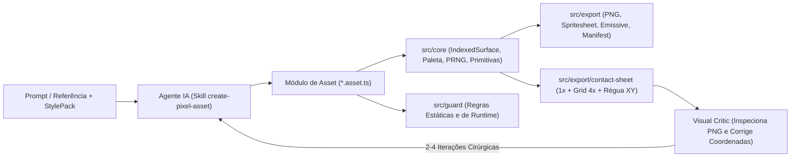

# pixelforge

Motor determinístico de pixel art indexada em código, CLI/SDK e ciclo de auto-crítica visual por agentes multimodais de IA para gerar PNGs pixel-perfect, spritesheets animados, máscaras emissivas e manifestos tipados sem mixels.

**[English](README.md)** | **[Português (Brasil)](README.pt-br.md)**

[-339933.svg)](https://nodejs.org/)
[](https://www.typescriptlang.org/)
[](docs/DESIGN_MVP.md)

---

## Visão Geral

O `pixelforge` elimina os modos de falha estruturais de geradores de pixel art baseados em difusão raster (mixels, halos semi-transparentes, deriva de paleta entre sprites, instabilidade entre frames de animação e PNGs sem metadados de âncoras) ao modelar cada asset como um módulo TypeScript determinístico sobre um framebuffer indexado (`Uint8Array`).

Capacidades previstas no MVP ([`docs/DESIGN_MVP.md`](docs/DESIGN_MVP.md)):
- **Framebuffer Indexado Sem Mixels:** Superfícies `Uint8Array` em coordenadas inteiras (índices semânticos `0..254`, com `255` reservado para alpha binário `0`), com primitivas 2D e isométricas `2:1` (`rect`, `line`, `dither`, `spr`, `autoOutline`, `isoBox`, `edgeMask`).
- **Paletas Semânticas e Troca por LUT:** Tokens nomeados com flags de material (`outline`, `emissive`, `shadow`, `metal`, `accent`) permitindo alternância sem perdas entre estados/horários (`healthy`/`dusty`/`faulty`, `day`/`night`) sem redesenhar a geometria.
- **Exportação Headless em Milissegundos:** Codificação nativa em Node.js (`< 50ms` por sprite, sem dependência de navegador) gerando PNGs 1x, spritesheets horizontais, máscaras emissivas e `manifest.json` sincronizado com âncoras e hitboxes emitidos pelo código.
- **Ciclo de Crítica Visual Multimodal:** Gera folhas diagnósticas `.contact.png` (previews 1x em fundo claro/escuro, zoom 4x/8x com grade e régua de coordenadas `(x, y)`, matriz de estados/frames e swatches da paleta) para que agentes de IA inspecionem os pixels renderizados e apliquem correções cirúrgicas por coordenada.
- **Guard Tests Determinísticos:** Checagens estáticas e em tempo de execução bloqueando `Math.random`, imports de imagens externas, hex literais fora da paleta, alpha intermediário e saídas não determinísticas.

## Arquitetura



As decisões arquiteturais estão registradas em [`docs/adr/decisions.md`](docs/adr/decisions.md) e a especificação completa de contratos está em [`docs/DESIGN_MVP.md`](docs/DESIGN_MVP.md).

## Início Rápido

> Estado atual do repositório: especificação greenfield concluída (`[00.0]`). O bootstrap de toolchain e o esqueleto da CLI começam na Tarefa `[00.1]` ([`.agent/TASK.md`](.agent/TASK.md)).

### Pré-requisitos

- Node.js `>= 24` (recomendado: **Node.js 26 Active LTS**)
- `pnpm`

### Fluxo Local Previsto (após `[00.1]`)

```bash
cp .env.example .env
pnpm install --frozen-lockfile
pnpm test
pnpm build
```

## Configuração

Sobrescritas opcionais de ambiente declaradas em [`.env.example`](.env.example):

| Variável | Descrição | Padrão | Obrigatória |
| :--- | :--- | :--- | :--- |
| `PIXELFORGE_OUT_DIR` | Diretório de saída para PNGs exportados, spritesheets, máscaras emissivas e `manifest.json` | `dist` | Não |
| `PIXELFORGE_SHEETS_DIR` | Diretório de folhas efêmeras `.contact.png` de crítica visual (ignorado no Git) | `.pixelforge/sheets` | Não |
| `PIXELFORGE_DEFAULT_STYLE` | Identificador padrão de `StylePack` usado pelo comando `pixelforge init` | `homelab-16bit` | Não |
| `LLM_BASE_URL` | Endpoint opcional de gateway OpenAI v1 (`hydra-llm-router`) para modo crítico automatizado na Fase 3 | `http://127.0.0.1:3000/v1` | Não |
| `LLM_API_KEY` | Token opcional do gateway quando o modo crítico automatizado da Fase 3 estiver ativo | `sk-replace-with-hydra-tier-token` | Apenas no modo automatizado (Fase 3) |
| `LLM_MODEL_FAST` | Alias virtual de baixa latência no gateway LLM | `fast` | Não |
| `LLM_MODEL_DEEP` | Alias virtual de raciocínio profundo no gateway LLM | `deep` | Não |
| `LLM_TIMEOUT_SECONDS` | Timeout HTTP em segundos para chamadas de raciocínio profundo no gateway | `180` | Não |

## Referência da CLI (Superfície Prevista do MVP)

```bash
# Inicializar um StylePack e um módulo de asset de exemplo
pixelforge init --style homelab-16bit

# Renderizar PNGs 1x, spritesheets horizontais, máscaras emissivas, manifest.json e contact sheet
pixelforge render old_laptop --sheet --emissive

# Executar guard tests estáticos e de runtime (código de saída 0 se aprovado)
pixelforge check

# Gerar comparação lado a lado + diff de pixels contra uma ref Git
pixelforge diff old_laptop --base HEAD
```

## Desenvolvimento

### Estrutura do Projeto

```text
├── .agent/
│   ├── TASK.md              # Checklist da tarefa ativa e roadmap
│   ├── NOTES.md             # Contratos ativos de módulos/CLI e gotchas
│   ├── INVARIANTS.md        # Guardrails de renderização e verificação de interface
│   ├── ARCHIVE.md           # Ciclos de tarefas arquivados
│   ├── hooks/               # Hooks de ciclo de vida para worktrees e verificação
│   ├── knowledge/           # Cards atômicos de gotchas de plataforma/runtime
│   └── skills/              # Skills herméticas do projeto (create-pixel-asset em [02.2])
├── docs/
│   ├── DESIGN_MVP.md        # Especificação canônica do MVP e contratos
│   └── adr/decisions.md     # Diário de Decisões Arquiteturais (ADRs)
├── src/                     # Motor core, exportador, guard runner e CLI (criado em [00.1]+)
├── styles/                  # Definições de StylePack (piloto homelab-16bit em [03.1])
├── assets/                  # Módulos *.asset.ts desenhados em código (pacote piloto em [03.1])
├── tests/                   # Suítes herméticas Vitest (unitários e guard tests)
├── .env.example             # Modelo de variáveis de ambiente
└── AGENTS.md                # Constituição de engenharia e regras para agentes
```

### Comandos de Validação

Checagens canônicas configuradas em `[00.1]` e obrigatórias antes de concluir qualquer tarefa:

```bash
pnpm typecheck
pnpm lint
pnpm test
pnpm build
git diff --check
```

## Licença

Privado / Interno (`ye-sandbox`).
