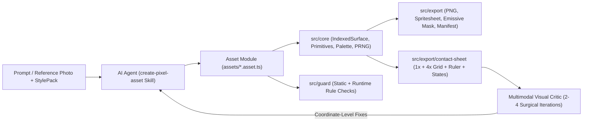

# `pixelforge` — MVP Design & Architecture Specification

> **Mission:** Build a deterministic, code-drawn indexed pixel art generator (`@pixelforge/core` + CLI/SDK) paired with a closed-loop **multimodal AI agent Visual Critic workflow** that produces production-ready PNGs, animated spritesheets, emissive masks, and typed `manifest.json` metadata with zero mixels.

---

## 1. Problem Statement & Core Thesis

Standard image-diffusion generators fail systematically on production game/UI pixel art across five axes:
1. **Mixels & Anti-Aliasing:** Inconsistent pixel grid scale, soft alpha edges, and sub-pixel blur.
2. **Cross-Asset Drift:** Perspective, lighting angle, and palette drift across sprites in the same pack.
3. **Non-Surgical Edits:** Changing one LED color, adding dust, or toggling night mode forces full regeneration and alters silhouette geometry.
4. **Unstable Animation Frames:** Multi-frame spritesheets jitter and lose identity across frames.
5. **Silent Assets:** Raw raster PNGs carry no semantic anchors (`footY`, LED positions, hitboxes) or emissive masks.

`pixelforge` synthesizes two proven engineering patterns into a standalone developer tool:
* **From `ovinidev/LofiCity`:** 100% code-drawn indexed framebuffer (`Uint8Array`), semantic palettes with material flags (`emissive`, `outline`, `shadow`), parametric prop kits returning geometric metadata, static guard tests (`scene-rules`), and a visual self-critique feedback loop where the agent inspects its own rendered PNGs.
* **From `ye-sandbox/idle-datacenter`:** Strict `StylePack` contracts (`STYLE_GUIDE.md`), dual-view scale discipline (`front-2.5d` + `iso-2:1`), typed asset manifests (`manifest.ts`), and parametric state variations (`healthy`, `dusty`, `faulty`).

---

## 2. Non-Negotiable Invariants

1. **Zero Mixels:** Every pixel is authored at integer coordinates `(x | 0, y | 0)` into a fixed `width x height` indexed `Uint8Array` buffer.
2. **Binary Alpha:** Index `255` (`TRANSPARENT_INDEX`) maps strictly to RGBA alpha `0`; indices `0..254` map strictly to RGBA alpha `255` (zero semi-transparent halo fringes).
3. **Closed Semantic Palette:** Asset modules draw exclusively with named palette indices from their declared `StylePack`. Raw hex strings inside drawing code are forbidden.
4. **Bit-for-Bit Determinism:** Rendering an asset twice with identical `(state, frame, seed)` produces byte-identical pixel buffers and PNG digests. `Math.random()` is banned by static guard tests.
5. **Headless Millisecond Rendering:** Exporting 1× PNGs, spritesheets, emissive masks, and 4×/8× contact sheets runs purely in Node.js (`< 50 ms` per sprite) without launching a browser.
6. **Code-Coupled Metadata:** Anchors (`foot`, `led`, `socket`) and hitboxes are emitted by the same code that places pixels, guaranteeing zero coordinate drift in `manifest.json`.

---

## 3. System Architecture (Single-Package MVP)



### Target Repository Layout
```text
pixelforge/
├── src/
│   ├── core/
│   │   ├── surface.ts        # IndexedSurface (Uint8Array), layers, blitting, bounds
│   │   ├── palette.ts        # Semantic Palette, PaletteFlags, LUT variants (day/night/status)
│   │   ├── prng.ts           # Deterministic mulberry32 & hashf
│   │   ├── primitives.ts     # put, rect, line, ellipse, floodFill, dither, spr (ASCII grid)
│   │   ├── pixel-ops.ts      # autoOutline, isoBox (2:1), edgeMask (top/bottom edges)
│   │   └── types.ts          # StylePack, AssetModule, Anchor, Hitbox, RenderContext
│   ├── export/
│   │   ├── png.ts            # Pure-TS/JS PNG encoder (RGBA -> Buffer)
│   │   ├── bundle.ts         # 1x PNG, horizontal spritesheet, emissive mask, manifest.json
│   │   ├── contact-sheet.ts  # 1x dark/light + zoomed pixel grid + (x,y) ruler + swatches
│   │   └── diff.ts           # Side-by-side + pixel-diff PNG generator
│   ├── guard/
│   │   ├── rules.ts          # Static source rules & runtime determinism/palette checks
│   │   └── runner.ts         # Discovery & structured violation reporter
│   ├── cli/
│   │   └── main.ts           # Thin CLI: init, render, check, diff
│   └── index.ts              # Public SDK exports
├── styles/
│   └── homelab-16bit.style.ts # Pilot StylePack (mirrors idle-datacenter STYLE_GUIDE)
├── assets/
│   └── homelab/              # Pilot assets (3 hardware sprites + 1 isometric room)
├── tests/
│   ├── core/
│   ├── export/
│   └── guard/
└── .agent/
    └── skills/
        └── create-pixel-asset/SKILL.md # Authored in [02.2]
```

---

## 4. Core TypeScript Contracts

### 4.1 Semantic Palette & `StylePack`
```typescript
export type PaletteFlag = 'outline' | 'emissive' | 'shadow' | 'metal' | 'accent' | 'surface';

export interface PaletteColorSpec {
  readonly index: number;              // 0..254 (255 reserved for transparent)
  readonly name: string;               // Semantic token, e.g. 'OUTLINE', 'LED_GREEN'
  readonly hex: `#${string}`;          // Canonical base hex (#rrggbb)
  readonly flags?: readonly PaletteFlag[];
}

export interface StylePack {
  readonly id: string;                 // Kebab-case, e.g. 'homelab-16bit'
  readonly perspective: 'front-2.5d' | 'iso-2:1' | 'top-down' | 'side';
  readonly lightingAngle: 'top-left' | 'top-right' | 'top';
  readonly outlineIndex: number;
  readonly palette: readonly PaletteColorSpec[];
  readonly variants?: Readonly<Record<string, Readonly<Record<string, `#${string}`>>>>;
}
```

### 4.2 Asset Module Contract (`*.asset.ts`)
```typescript
export interface AnchorPoint {
  readonly name: string;
  readonly x: number;
  readonly y: number;
}

export interface HitboxRect {
  readonly name: string;
  readonly x: number;
  readonly y: number;
  readonly w: number;
  readonly h: number;
}

export interface RenderContext<TState extends string = string> {
  readonly surface: IndexedSurface;
  readonly style: StylePack;
  readonly state: TState;
  readonly frame: number;
  readonly frameCount: number;
  readonly rng: () => number;          // Seeded mulberry32
  anchor(name: string, x: number, y: number): void;
  hitbox(name: string, x: number, y: number, w: number, h: number): void;
}

export interface AssetModule<TState extends string = 'default'> {
  readonly id: string;                 // Unique kebab-case or snake_case key
  readonly styleId: string;
  readonly width: number;
  readonly height: number;
  readonly perspective: 'front-2.5d' | 'iso-2:1' | 'top-down' | 'side';
  readonly states: readonly TState[];  // e.g. ['healthy', 'dusty', 'faulty']
  readonly frames: number;             // >= 1
  readonly fps?: number;               // Required when frames > 1
  readonly seed?: number;              // Default deterministic seed
  render(ctx: RenderContext<TState>): void;
}
```

### 4.3 Export Manifest Contract (`dist/manifest.json`)
```typescript
export interface ExportedAssetManifestEntry {
  readonly id: string;
  readonly styleId: string;
  readonly perspective: string;
  readonly width: number;
  readonly height: number;
  readonly states: readonly string[];
  readonly frames: number;
  readonly fps: number;
  readonly files: {
    readonly states: Readonly<Record<string, string>>;       // e.g. { healthy: "old_laptop_healthy.png" }
    readonly sheet?: string;                                 // Horizontal spritesheet if frames > 1
    readonly emissive?: Readonly<Record<string, string>>;    // Emissive-only mask PNGs
  };
  readonly anchors: readonly AnchorPoint[];
  readonly hitboxes: readonly HitboxRect[];
  readonly sha256: string;                                   // Deterministic content digest
}
```

---

## 5. Contact Sheet & Multimodal Visual Critic Loop

To let AI agents perform **coordinate-level surgical edits** instead of blind retries, `pixelforge render <asset> --sheet` generates `.pixelforge/sheets/<id>.contact.png` with a fixed diagnostic layout:

1. **Header Bar:** Asset `id`, dimensions (`W×H`), `styleId`, `perspective`, and frame count.
2. **1× True-Size Strip:** Rendered on both dark (`#0d1117`) and light (`#e6edf3`) checkerboards so silhouette readability and contrast are immediately falsifiable.
3. **Zoomed Inspection Panel (`4×` or `8×`):** Nearest-neighbor upscale with subtle 1px grid lines, **every-4px coordinate tick ruler `(0, 4, 8, ...)`** along top and left axes, and optional crosshairs marking declared `anchors`.
4. **State & Frame Matrix:** Every `(state, frame)` combination rendered side-by-side (`healthy` | `dusty` | `faulty`) plus an emissive-only silhouette preview.
5. **Used Palette Swatches:** Exact subset of palette tokens used by the asset, highlighting unused or outlier colors.

### Agent Iteration Protocol (Codified in `[02.2]` `create-pixel-asset` Skill)
1. **Plan:** Define silhouette proportions, layer order (chassis -> recesses -> shading -> highlights -> LEDs -> outline), and anchor list before coding.
2. **Author:** Implement `assets/<pack>/<id>.asset.ts` using `@pixelforge/core` primitives and `StylePack` tokens.
3. **Guard Check:** Run `pixelforge check <id>` — must exit `0` before visual inspection.
4. **Render & Inspect:** Run `pixelforge render <id> --sheet` and open `.pixelforge/sheets/<id>.contact.png` directly.
5. **Critique & Refine (2–4 passes max):** Evaluate 1× silhouette, lighting consistency (`top-left`), pixel cluster cleanliness (no stray orphan pixels), state legibility, and anchor placement. Apply exact coordinate edits using the ruler until approved.

---

## 6. Guard Rules (`pixelforge check`)

Static + runtime checks modeled on `LofiCity/test/scene-rules.test.ts`:

| Rule ID | Mode | Enforcement |
| :--- | :---: | :--- |
| `no-math-random` | Static | Bans `Math.random` in `assets/**`, `styles/**`, and `src/core/**` |
| `no-external-assets` | Static | Bans image imports/paths (`.png`, `.jpg`, `.webp`, `.svg`) and DOM/Canvas APIs inside asset modules |
| `no-raw-hex` | Static | Bans literal `#rrggbb` strings inside `assets/**` (palette indices only) |
| `closed-palette` | Runtime | Fails if any written surface pixel is not `TRANSPARENT_INDEX (255)` or a declared `StylePack` index |
| `exact-dimensions` | Runtime | Fails if rendered surface dimensions diverge from `asset.width x asset.height` |
| `binary-alpha` | Runtime | Asserts exported RGBA buffer contains exclusively alpha `0` or `255` |
| `bit-determinism` | Runtime | Renders every `(state, frame)` twice and asserts identical SHA-256 pixel digest |
| `valid-anchors` | Runtime | Asserts declared anchors and hitboxes lie within `[0, width]` × `[0, height]` with unique names |

---

## 7. CLI Surface

```bash
pixelforge init [--style homelab-16bit]        # Scaffold StylePack and sample asset module
pixelforge render [asset-id] [--out dist] [--sheet] [--scale 1] [--emissive]
pixelforge check [asset-id]                    # Run static + runtime guard rules (CI-ready exit codes)
pixelforge diff <asset-id> [--base HEAD]       # Render before/after + highlighted pixel-diff PNG
```

---

## 8. Pilot Validation Benchmark (`[03.1]`)

The MVP is considered **validated** when the CLI + `create-pixel-asset` skill produces a cohesive `homelab-16bit` pack matching `idle-datacenter`'s visual spec with zero manual image editing:

| Asset | Perspective | Dimensions | States / Frames | Target Validation |
| :--- | :--- | :---: | :--- | :--- |
| `old_laptop` | `front-2.5d` | `32×32` | `healthy`, `dusty`, `faulty` · 2 frames (LED blink) | Crisp 1× readability, visible terminal screen, clean outline |
| `used_gpu_rig` | `front-2.5d` | `64×48` | `healthy`, `dusty`, `faulty` · 2 frames (fan/LED) | 3 distinct GPUs, PSU, riser cables, dust/spark overlays |
| `ai_cluster_node` | `front-2.5d` | `64×48` | `healthy`, `dusty`, `faulty` · 2 frames (coolant glow) | Emissive cyan manifold mask + telemetry LED strip |
| `bedroom_desk_iso` | `iso-2:1` | `320×200` | `day`, `night` · 1 frame | 2:1 isometric geometry + exported `hardwareAnchors` & `breakerAnchor` |

---

## 9. Deferred Scope (Phase 2 — Post-MVP)

* **Interactive Web Studio (Svelte 5 + Tailwind v4 + WebGL2):** Live hot-reload preview of `.asset.ts` modules with WebGL2 emissive bloom, CRT/grain toggles (inspired by `LofiCity/src/engine/post.ts`), and interactive pixel-coordinate hover inspector.
* **Animated GIF / APNG Export:** Direct animated preview exports alongside horizontal PNG spritesheets.
* **Automated Headless Critic Mode:** Optional OpenAI v1 multimodal call via `hydra-llm-router` (`LLM_BASE_URL`) for batch CI visual scoring.
