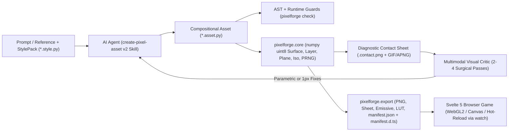

# `pixelforge` v2 — Python Compositional Pixel Art Compiler (`build123d`-Style)

> **Mission:** Build a deterministic, code-drawn indexed pixel art compiler in Python (`pixelforge` SDK + CLI) using a `build123d`-inspired compositional context-manager API (`with Asset(...)`, `with Layer(...)`, `with Plane(...)`) paired with a 100% AI-agent **multimodal Visual Critic Loop**, compiling `.asset.py` modules into production-ready PNGs, animated spritesheets, emissive masks, optional 1D LUT textures, animated GIF/APNG previews, and strictly typed `manifest.json` + `manifest.d.ts` artifacts for **Svelte 5** browser games (or any engine).

---

## 1. Core Thesis & Decoupled Compiler Architecture

Inspired by **`build123d`** (where expressive Python CAD compiles to standard `.step`/`.stl`/`.glb` artifacts consumed by external runtimes), `pixelforge` v2 cleanly separates **asset authoring (build-time)** from **game execution (runtime)**:

- **Build-Time (Python Compiler — `pixelforge`):** Multimodal AI agents author concise, parametric `.asset.py` modules, validate them via stdlib `ast` + runtime guards, inspect coordinate-ruled `.contact.png` sheets, and apply surgical edits.
- **Runtime (Svelte 5 Browser Game):** Consumes zero-overhead compiled artifacts — pixel-perfect 1× PNGs, spritesheets, emissive masks, optional indexed + 1D LUT textures for 60 FPS WebGL2 palette swaps, and auto-generated **`manifest.d.ts`** for full TypeScript autocomplete.



---

## 2. Non-Negotiable Invariants

1. **Zero Mixels:** Every pixel is authored on an integer grid into a fixed `height x width` indexed `numpy.ndarray(dtype=np.uint8)` buffer. Anti-aliasing and sub-pixel blending are prohibited.
2. **Binary Alpha:** Index `255` (`TRANSPARENT_INDEX`) maps strictly to RGBA alpha `0`; indices `0..254` map strictly to RGBA alpha `255`.
3. **Closed Semantic Palette:** Asset modules draw exclusively via named tokens from their declared `StylePack`. Raw `#rrggbb` literals inside `assets/**` are banned by AST guard.
4. **Bit-for-Bit Determinism:** Identical `(state, frame, seed)` inputs yield byte-identical framebuffers and SHA-256 digests. Python `random`, wall-clock APIs (`time`, `datetime`), and I/O are banned inside `assets/**` by AST guard.
5. **Parametric + Surgical Escape Hatch:** High-level compositional blocks (`with a.layer(...)`, `with a.plane(...)`, `iso_box`, `dither`, `bevel`) handle 90% of geometry, while explicit pixel escape hatches (`put`, `erase`, `line`, `spr`) preserve 100% 1px surgical refinement from the `.contact.png` ruler.
6. **Headless Millisecond Rendering (`< 40 ms`):** Vectorized `numpy` primitives + `Pillow` PNG/GIF encoding keep the visual critic loop fast without launching a browser.
7. **Code-Coupled Typed Metadata:** `anchor()` and `hitbox()` emit coordinates from the exact geometry layer that draws them, exported to both `manifest.json` and Svelte-ready `manifest.d.ts`.

---

## 3. Target Repository Layout (v2 Python)

```text
pixelforge/
├── pyproject.toml                   # uv, Python >= 3.14, ruff, pyright strict, pytest
├── uv.lock                          # Managed strictly via uv
├── src/
│   └── pixelforge/
│       ├── __init__.py              # Public SDK exports (Asset, StylePack, Layer, Plane, ...)
│       ├── core/
│       │   ├── types.py             # StylePack, PaletteColor, Anchor, Hitbox, PerspectiveMode
│       │   ├── surface.py           # IndexedSurface (numpy uint8), rect, rounded_rect, line, circle, ellipse, polygon, quad, fill, dither, spr, mirror_x, auto_outline, sel_out, edge_mask
│       │   ├── palette.py           # PaletteLookup (fail-loud), LUT builder, variant overrides
│       │   ├── prng.py              # Deterministic mulberry32 & hashf (uint32)
│       │   ├── iso.py               # iso_project, iso_tile, iso_box (2:1 isometric)
│       │   ├── plane.py             # Plane context manager & (u, v) affine projection
│       │   └── builder.py           # build123d-style Asset & Layer context managers, masking, scatter
│       ├── export/
│       │   ├── png.py               # Surface -> RGBA / indexed / 1D LUT -> Pillow PNG bytes
│       │   ├── bundle.py            # State PNGs, horizontal sheet, emissive sheet, GIF/APNG, manifest.json
│       │   ├── svelte_types.py      # Auto-generator for manifest.d.ts (typed IDs, states, anchors, hitboxes)
│       │   ├── contact_sheet.py     # 1x dark/light, zoomed ruler grid, hitboxes, anchors, untruncated swatches, metrics
│       │   └── diff.py              # Side-by-side + magenta pixel-diff PNG generator
│       ├── guard/
│       │   ├── ast_rules.py         # stdlib ast.parse static checks (zero regex fragility)
│       │   ├── runtime_rules.py     # Dimensions, closed palette, binary alpha, determinism, anchors, orphan diagnostics
│       │   └── runner.py            # importlib discovery, git-ref loader, violation formatter
│       └── cli/
│           └── main.py              # Thin CLI: init, render, check, diff, watch, analyze-ref
├── styles/
│   └── homelab_16bit.style.py       # Pilot StylePack (fixing WINDOW_SKY emissive semantics)
├── assets/
│   ├── homelab/                     # Ported pilot pack (old_laptop, used_gpu_rig, ai_cluster_node, bedroom_desk_iso)
│   └── thinkpad/                    # Ported ThinkPad showcase assets
├── tests/
│   ├── core/
│   ├── export/
│   ├── guard/
│   ├── cli/
│   └── test_homelab_pilot.py
└── .agent/
    └── skills/
        └── create-pixel-asset/SKILL.md
```

---

## 4. `build123d`-Style Compositional Authoring API

```python
from pixelforge import Asset, AssetSpec

SPEC = AssetSpec(
    id="thinkpad_r51_iso",
    style_id="homelab-16bit",
    width=64,
    height=64,
    perspective="iso-2:1",
    states=("healthy", "dusty", "faulty"),
    frames=2,
    fps=2,
    seed=510,
)


def render(a: Asset) -> None:
    P = a.pal  # Typed fail-loud palette lookup bound to active StylePack

    with a.layer("lid", outline=P.OUTLINE):
        with a.plane(p0=(22, 4), p1=(57, 13), p2=(17, 30)) as lid:
            lid.rect(0.0, 0.0, 1.0, 1.0, fill=P.SLATE_DARK, bevel=(P.SLATE_LIGHT, P.SHADOW))
            lid.rect(0.08, 0.11, 0.84, 0.76, fill=P.METAL_LIGHT)
            lid.anchor("screen", 0.5, 0.5)

    with a.layer("deck", outline=P.OUTLINE):
        with a.plane(p0=(17, 32), p1=(52, 41), p2=(5, 49)) as deck:
            deck.rect(0.0, 0.0, 1.0, 1.0, fill=P.SLATE_MID, extrude_y=3, side=P.SHADOW)
            deck.grid(0.07, 0.08, 0.83, 0.46, cols=13, rows=4, color=P.SLATE_DARK)
            deck.dot(0.45, 0.29, P.FAULT_RED, anchor="trackpoint")

    if a.state == "dusty":
        a.scatter(count=16, colors=(P.DUST_LIGHT, P.DUST_DARK), mask="opaque")

    # 1px surgical escape hatch directly on global integer coordinates
    if a.state == "healthy" and a.frame == 0:
        a.put(31, 14, P.CYAN_GLOW)

    a.hitbox("body", 4, 3, 55, 58)
```

### Key Compositional Primitives
- **`with a.layer(name, *, offset=(0, 0), outline=None, sel_out=None, mirror_x=False)`**: draws onto an isolated local `IndexedSurface`, applies optional mirroring/outline/bevel on exit, and composites non-transparent pixels onto the parent surface.
- **`with a.plane(p0, p1, p2)`**: maps normalized `(u, v)` coordinates onto any angled/isometric quadrilateral via integer affine projection (`rect`, `grid`, `line`, `dot`, `anchor`).
- **Pixel Primitives**: `put`, `erase`, `get`, `rect`, `rounded_rect`, `line`, `circle`, `ellipse`, `polygon`, `quad`, `fill`, `dither` (Bayer 2×2, Bayer 4×4, checker), `spr` (ASCII grid), `scatter` (deterministic masked placement), `auto_outline`, `sel_out`, `edge_mask`, `mirror_x`, `flip_x`, `flip_y`, `iso_box`, `iso_tile`.

---

## 5. AST + Runtime Guard Rules (`pixelforge check`)

| Rule ID | Mode | Enforcement |
| :--- | :---: | :--- |
| `no-stdlib-random` | AST | Bans `random`, `secrets`, `numpy.random` in `assets/**`, `styles/**`, and `src/pixelforge/core/**` |
| `no-external-assets` | AST | Bans raster/SVG paths (`.png`, `.jpg`, `.webp`, `.svg`, `.gif`) and `PIL`/`Image` imports inside `assets/**` |
| `no-raw-hex` | AST | Bans literal `#rrggbb` color strings inside `assets/**` (ignores `spr()` ASCII grids cleanly via AST context) |
| `no-io-or-eval` | AST | Bans `open`, `pathlib`, `os`, `subprocess`, `eval`, `exec`, `time`, `datetime` inside `assets/**` |
| `exact-dimensions` | Runtime | Rendered surface shape equals `(asset.height, asset.width)` |
| `closed-palette` | Runtime | Every pixel is `255` (`TRANSPARENT_INDEX`) or a declared `StylePack` index |
| `binary-alpha` | Runtime | Exported RGBA pixels have alpha strictly in `{0, 255}` |
| `bit-determinism` | Runtime | Rendering every `(state, frame)` twice yields identical SHA-256 pixel digests |
| `valid-anchors` | Runtime | Anchors and hitboxes lie within `[0, width] x [0, height]` with unique names per `(state, frame)` |
| `orphan-pixels` | Diagnostic | Reports isolated 1×1 pixels (advisory by default; `--strict-orphans` turns into error) |

---

## 6. Export Pipeline & Svelte 5 Integration

`pixelforge render` produces a self-contained output bundle under `PIXELFORGE_OUT_DIR` (default `dist/`):

- `sprites/<id>_<state>.png` — 1× (or `--scale N`) binary-alpha PNG.
- `sprites/<id>_sheet.png` — Horizontal spritesheet (`frames * width` × `states * height`) when `frames > 1`.
- `sprites/<id>_<state>_emissive.png` & `sprites/<id>_sheet_emissive.png` — Emissive-only masks for WebGL2 bloom.
- `sprites/<id>_<state>_idx.png` & `sprites/<style>_lut.png` (when `--lut` is passed) — Indexed texture + 1D palette LUT for 60 FPS WebGL2 palette swaps in Svelte.
- `.pixelforge/sheets/<id>.contact.png` (when `--sheet` is passed) — Diagnostic contact sheet with full untruncated palette token names + `[E]` markers, hitbox overlays, anchor crosshairs, 1× dark/light strips, zoomed ruler, state/frame matrix, and pixel metrics.
- `.pixelforge/previews/<id>_<state>.gif` (or `.apng`, when `--animate` is passed and `frames > 1`) — Animated preview to verify zero animation jitter.
- `manifest.json` + **`manifest.d.ts`** — Deterministic JSON manifest (with per-state/per-frame anchor support when coordinates vary) paired with a generated TypeScript declaration file so Svelte 5 games get strict compile-time typing for every sprite ID, state, frame count, FPS, anchor, and hitbox.

---

## 7. CLI Surface

```bash
pixelforge init [--style homelab-16bit] [--force]
pixelforge render [asset-id] [--out dist] [--sheet] [--animate] [--emissive] [--lut] [--scale 1] [--variant <name>]
pixelforge check [asset-id] [--strict-orphans]
pixelforge diff <asset-id> [--base HEAD] [--out .pixelforge/diffs]
pixelforge watch [asset-id] [--out ../my-svelte-game/static/sprites] [--sheet] [--emissive]
pixelforge analyze-ref <image-path> --style homelab-16bit --size 64x64   # Ephemeral sketch/proportion guide (Phase 5)
```

All defaults respect `.env` / environment overrides (`PIXELFORGE_OUT_DIR`, `PIXELFORGE_SHEETS_DIR`, `PIXELFORGE_DEFAULT_STYLE`) loaded via `pydantic-settings`.

---

## 8. Proposed Dependencies (Subject to Explicit User Approval in `[00.1]`)

Per `AGENTS.md` §6 (Consultative Dependency Governance) and `ye-sandbox` `stack-decisions`:
- **Runtime:** Python `>= 3.14` (managed via `uv`), `numpy`, `pillow`, `pydantic >= 2.11`, `pydantic-settings` (and optionally `typer` vs stdlib `argparse` — trade-offs presented in `[00.1]` plan).
- **Dev / Verification:** `ruff >= 0.17`, `pyright >= 1.1.400` (strict), `pytest >= 8.4`, `pytest-socket`.
